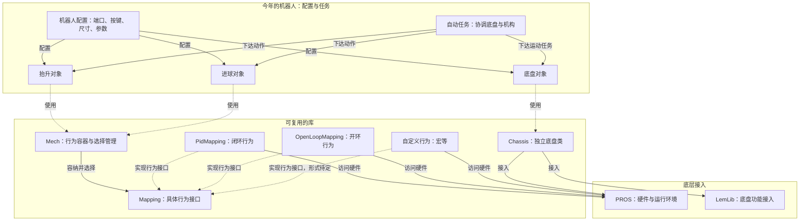

# 机器人库：整体框架

状态：设计草案，整理于 2026-09-30。本文只描述结构，不包含 C++ 实现。

本文采用 Markdown + Mermaid。支持 Mermaid 的 Markdown 查看器可以显示图形，普通文本编辑器也能直接修改节点和关系。

相关文档：[Mech 内部行为](02-mech-behaviors.md)。

## 框架图

箭头旁的文字说明关系；图中的连线不代表 C++ 继承关系。

## 当前设计方向

- **库与今年的机器人分开**：通用能力进入库；端口、按键绑定、参数、具体路线和比赛任务属于机器人配置与任务。
- **Mech 是行为容器**：根据比赛状态管理自动行为、手动行为，以及可能存在的宏行为。PID、按键读取等控制细节由行为负责。
- **Chassis 与 Mech 并列**：底盘独立处理驾驶、定位和路径相关功能，计划基于 PROS 与 LemLib 实现。这项设计仍保留为草案，未写入 AGENTS.md。
- **自动任务协调对象**：例如底盘移动到取球点，然后启动进球机构。此处表示职责，暂不要求为每个框都创建类。
- **命名遵循已确定的习惯**：类型使用 PascalCase，参数、变量和方法使用 snake_case，例如 auton_mapping。

## 尚未确定

- 底盘的路径功能范围：预设路径跟随，还是还需要根据障碍物规划路径；此图不承诺 LemLib 覆盖全部需求。
- 比赛状态由谁提供、行为由谁周期更新，以及更新周期如何配置。
- 硬件对象的持有位置、共享方式与生命周期；图中访问 PROS 的箭头不表示每个行为都创建自己的电机对象。
- 跨机构宏放在哪里、怎样协调；目前建议由机器人层组织，尚未定案。
- Mech 是否保留 set、toggle，以及切换行为后目标值如何处理。

## 文件与仓库

当前目录只用于讨论和保存设计资料，不初始化 Git 仓库。实际代码仓库由用户稍后提供。

机器人配置文件名尚未定案；若统一采用下划线命名，可考虑 robot_config.cpp。
