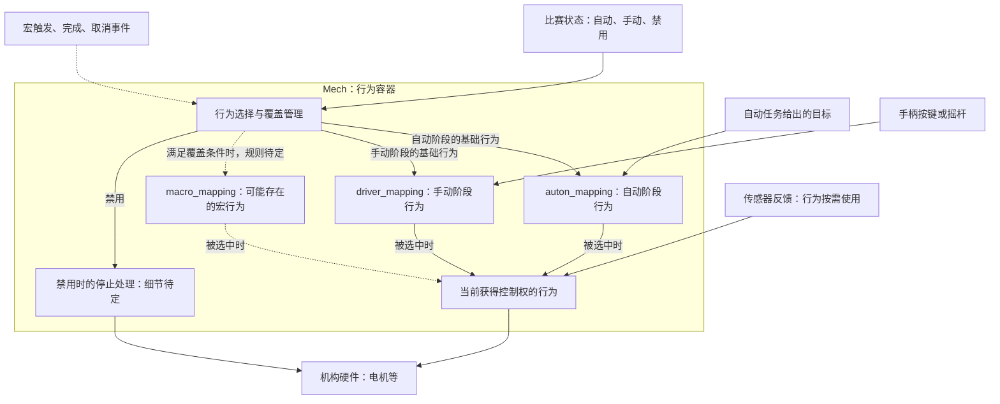

# Mech：内部行为与覆盖关系

状态：设计草案，整理于 2026-09-30。本文只描述结构和候选规则，不包含 C++ 实现。

相关文档：[整体框架](01-framework.md)。

## 核心思路

Mech 是一个行为容器。它根据比赛状态和行为触发情况，决定哪个行为获得控制权。自动控制、手动控制和宏的细节由对应 Mapping 实现。

这里的 Mapping 表示“行为”，不局限于数值转换。类名暂定为 Mech、Mapping、PidMapping 和 OpenLoopMapping。

## 内部关系图

实线表示容纳、选择或使用关系；虚线表示候选设计或待定规则。

## 抬升配置示例的含义

以下为配置含义，不是 C++ 构造语法。

| 配置项 | 用户示例中的行为 | 行为负责的内容 |
| --- | --- | --- |
| auton_mapping | PID 控制，参数 1、2、3 | 接收目标、读取反馈、计算输出 |
| driver_mapping | 按键 1、按键 2，stopping 为 hold | 根据按键控制输出，松开按键时执行 hold |
| macro_mapping | 某个自定义宏，可选 | 执行自定义动作；触发和完成机制待定 |

auton_mapping 和 driver_mapping 表示行为的使用场合，不限制实现类型。自动阶段也可以采用开环行为，手动阶段也可以采用 PID 行为。

hold 是手动行为在松开按键时的配置，不自动等同于比赛禁用时的停止策略。

## Mech 的职责边界

| Mech 负责 | Mapping 负责 |
| --- | --- |
| 保存各阶段的行为配置 | 具体控制逻辑 |
| 根据比赛状态选择行为 | 按需读取按键、目标或反馈 |
| 管理宏是否覆盖当前行为 | 计算并应用机构输出 |
| 管理切换、退出与停止 | 保存行为自身的运行状态 |

建议同一时刻仅允许一个行为控制机构输出。退出与启动行为需要约定统一的生命周期，但接口名称和实现方式尚未确定。

## 覆盖与切换：待确认

| 情况 | 当前状态或候选规则 |
| --- | --- |
| 自动阶段，无宏覆盖 | 选择 auton_mapping |
| 手动阶段，无宏覆盖 | 选择 driver_mapping |
| 比赛禁用 | 停止行为输出；具体停止策略待定 |
| 宏何时可以启动 | 仅手动阶段，还是自动阶段也允许，待定 |
| 宏运行时按下机构按键 | 建议取消宏并交还手动行为，尚未确认 |
| 宏完成或被取消 | 建议回到当前比赛阶段对应的行为，尚未确认 |
| 比赛阶段在宏运行中切换 | 宏是否取消、状态是否保留，待定 |
| 行为重新获得控制权 | 从头启动还是恢复进度、PID 是否重置，待定 |
| 多个宏或宏重复触发 | 是否支持多个宏，以及拒绝、重启或排队，待定 |
| 某阶段没有配置 Mapping | 是否允许，以及停止或其他处理方式，待定 |

## 后续讨论顺序

1. 确认宏适用的比赛阶段，以及触发、取消和完成规则。
2. 明确行为切换时如何停止旧行为、启动新行为。
3. 确定硬件对象由谁持有、行为如何访问。
4. 再决定构造配置和 set、toggle 等接口的具体形式。
